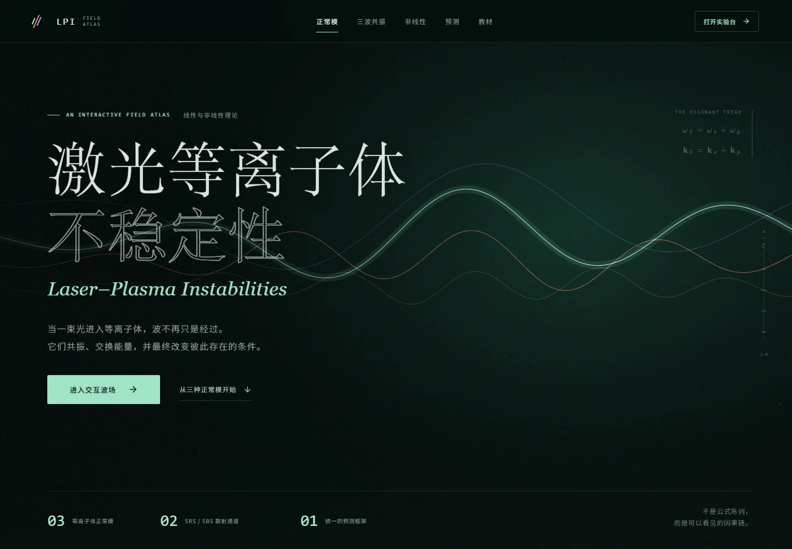
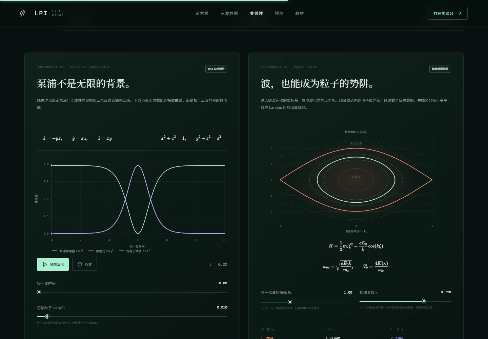
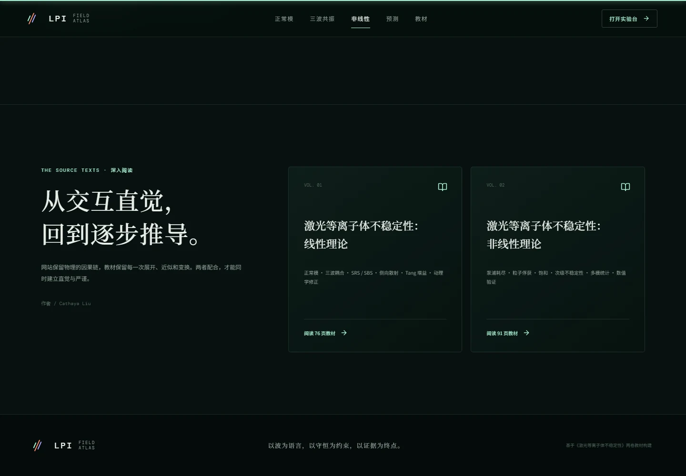

<div align="center">

# 激光等离子体不稳定性 · 交互波场图鉴

### Laser–Plasma Instabilities · An Interactive Field Atlas

**从三波共振到泵浦耗尽：一座可以离线运行的激光等离子体物理实验室**

</div>



这是一份面向高年级本科生、研究生与激光等离子体研究者的交互式学习图谱。它把教材中的方程、矢量几何与数值实验放进同一个暗色科学界面：不仅展示结论，也让读者亲手改变密度、温度、散射角和偏振，观察共振条件、增长率及非线性演化如何随之改变。

项目与《激光等离子体不稳定性：线性理论》《激光等离子体不稳定性：非线性理论》两本配套教材联动，可作为课前导学、课堂演示或推导后的物理直觉校验工具。

## 为什么值得打开

- **物理不是静态插图**：拖动参数即可重算三波匹配、偏振投影、阻尼增长率与空间增益。
- **线性与非线性相互衔接**：从指数增长进入泵浦耗尽、能量再分配、粒子俘获与反弹周期。
- **任意角几何可视化**：在同一幅波矢图中理解背向、侧向与前向散射，而不只记忆共线公式。
- **专业公式排版**：使用 KaTeX 渲染数学表达，符号、量纲与物理近似和教材保持一致。
- **真正离线**：样式、脚本、字体与公式全部内嵌，无需联网、数据库或应用服务器。
- **复制即可迁移**：保留整个 `offline` 文件夹，就能在其他电脑上直接打开。
- **桌面与移动端适配**：交互仪器、图表和教材入口均采用响应式布局。

## 交互仪器

### 01 · 三波共振实验室


在 **SRS（受激拉曼散射）** 与 **SBS（受激布里渊散射）** 之间切换，调节激光强度、电子密度、电子温度、散射角和偏振，实时观察：

- 电磁波、电子等离子体波与离子声波的色散关系；
- 频率匹配 $\omega_0=\omega_s+\omega_{p,a}$ 与波矢匹配 $\mathbf{k}_0=\mathbf{k}_s+\mathbf{k}_{p,a}$；
- 背向和侧向过程中的波矢闭合、散射光频率及增长率；
- 偏振投影对侧向散射的抑制；
- 有阻尼增长率、Debye 参数与模型适用性提示。

这里的关键不是把三个波画在一起，而是看到：**共振同时约束频率、波矢和偏振；改变散射角会改变整个耦合问题。**

### 02 · Tang 空间增益

把均匀等离子体中的时间增长问题转换为有限长度中的空间放大问题，观察泵浦强度、相互作用长度与增益之间的关系，并显式标出线性外推开始失效的区域。

教材参考算例用于展示增益标度，**不是可在任意参数区直接套用的普适反射率公式**。当指数增益过大时，应转向非线性模型，而不是继续信任指数曲线。

### 03 · 相干三波与泵浦耗尽



通过 RK4 数值积分，追踪入射光、散射光和等离子体波的振幅交换：

- 从微弱种子振幅开始，观察线性指数增长；
- 进入泵浦耗尽后，观察振幅饱和与相干回流；
- 用 Manley–Rowe 不变量检查能量交换的数值守恒性；
- 对比“无限泵浦”的线性近似与“有限泵浦”的非线性演化。

相干三波演示刻意保持模型简洁，不包含粒子俘获、多模竞争、谱展宽或复杂边界；这些效应应作为后续模型扩展，而非暗中混入当前方程。

### 04 · 粒子俘获与反弹周期

从有质动力势到非线性单摆方程，展示粒子由通过轨道进入俘获轨道的过程。反弹周期由完全椭圆积分计算，而非把有限振幅振荡误当成简谐运动。

这一模块连接了波场与粒子两个视角：**宏观波幅的变化，最终要在粒子相空间轨道中寻找解释。**

### 05 · 八步预测流程与概念测验

沿着“正常模 → 共振 → 偏振 → 增长率 → 适用性 → 空间增益 → 非线性饱和 → 守恒检查”的路径组织学习，并用概念测验检查常见误区。

## 模型边界

本图鉴用于建立可检验的物理直觉，不替代完整的实验设计或大规模动理学模拟。

| 模块 | 当前模型 | 需要特别注意 |
| --- | --- | --- |
| SRS | 自洽求解 Bohm–Gross 热修正色散关系 | 强阻尼区不能继续使用无阻尼增长率解释实验 |
| SBS | 采用 $\omega_a\ll\omega_0$、$k_s\simeq k_0$ 的长波近似 | 结果应与离子声波色散及 Landau 阻尼共同判断 |
| Tang 增益 | 均匀等离子体与教材参考算例的标度演示 | 大信号、非均匀流场和泵浦耗尽需要更完整模型 |
| 三波演化 | 相干、单模、固定相位的振幅方程 | 不包含多模、粒子俘获、噪声与复杂边界 |
| 粒子俘获 | 单一静电势波中的非线性轨道 | 不直接等同于真实多波、多尺度等离子体 |

## 离线使用

无需安装任何依赖，直接用现代浏览器打开：

```text
offline/index.html
```

推荐复制整个目录：

```text
offline/
├── index.html              # 单文件交互网站
├── favicon.svg
└── textbooks/
    ├── 线性理论.pdf
    └── 非线性理论.pdf
```

只复制 `index.html` 时，网页本身及交互仍可运行；若需要网页内的教材按钮，请同时保留 `textbooks` 文件夹。

## 本地开发

需要 Node.js 与 npm：

```bash
npm install
npm run dev
```

构建常规版本与离线版本：

```bash
npm run build
npm run build:offline
```

运行物理与数值校验：

```bash
node scripts/verify-physics.mjs
```

浏览器验证脚本位于 `scripts/validate.mjs` 与 `scripts/validate-offline.mjs`；当前脚本使用本机 Microsoft Edge，可按本机浏览器路径调整。

## 发布到 GitHub Pages

本项目可以直接部署为纯静态网站，不需要 GitHub Actions 或构建服务。

1. 在仓库根目录新建 `docs/`。
2. 将 **`offline/` 里面的内容**复制到 `docs/`，而不是多嵌套一层 `offline`。
3. 提交并推送到 GitHub。
4. 打开 `Settings → Pages`。
5. 选择 `Deploy from a branch`，分支选择 `main`，目录选择 `/docs`，保存。

目标目录应为：

```text
docs/
├── index.html
├── favicon.svg
└── textbooks/
    ├── 线性理论.pdf
    └── 非线性理论.pdf
```

部署完成后，地址通常为：

```text
https://<GitHub 用户名>.github.io/<仓库名>/
```

如果仓库启用了自定义域名，则以实际 Pages 设置为准。

## 已完成的验证

- **555 组 SRS 参数扫描、1680 项物理与数值断言通过**；
- Bohm–Gross 色散关系最大残差约为 $1.77\times10^{-16}$；
- 相干三波不变量最大残差约为 $3.35\times10^{-12}$；
- 复制离线目录后经 `file://` 实测，外部网络请求为 **0**；
- 离线公式、交互、教材相对路径及文件完整性检查通过；
- 桌面与移动端布局检查通过，无横向溢出或运行时异常。

这些检查验证的是当前方程实现与交互行为，并不意味着简化模型覆盖了全部真实等离子体物理。

## 配套教材



- **《激光等离子体不稳定性：线性理论》**：正常模、三波耦合、SRS／SBS、偏振与阻尼、Tang 空间增益。
- **《激光等离子体不稳定性：非线性理论》**：泵浦耗尽、Manley–Rowe 关系、有质动力、粒子俘获、波破碎与非线性频移。

教材作者：**Cathaya Liu**。

## 项目结构

```text
lpi-atlas/
├── assets/readme/          # README 展示图片
├── offline/                # 可直接打开、可部署的离线成品
├── scripts/                # 构建、物理与浏览器验证脚本
├── src/                    # React 界面、物理模型与样式
├── qa/                     # 验证报告与测试截图
├── index.html
├── package.json
└── vite.offline.config.js
```

上传 GitHub 时请保留 `assets/readme/`，否则本页图片无法显示；无需上传 `node_modules/`。

---

<div align="center">

**以波为语言，以守恒为约束，以证据为终点。**

</div>
